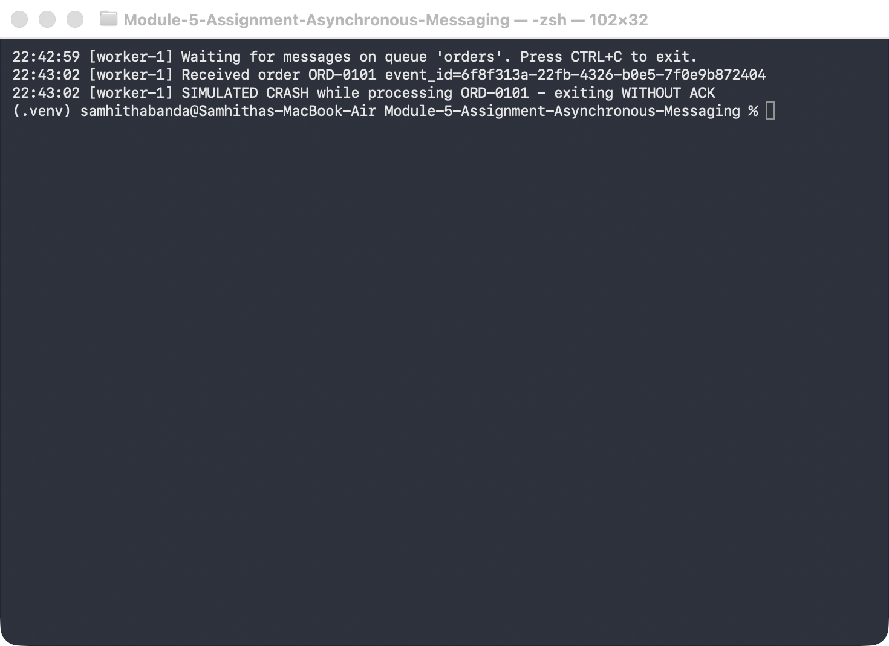
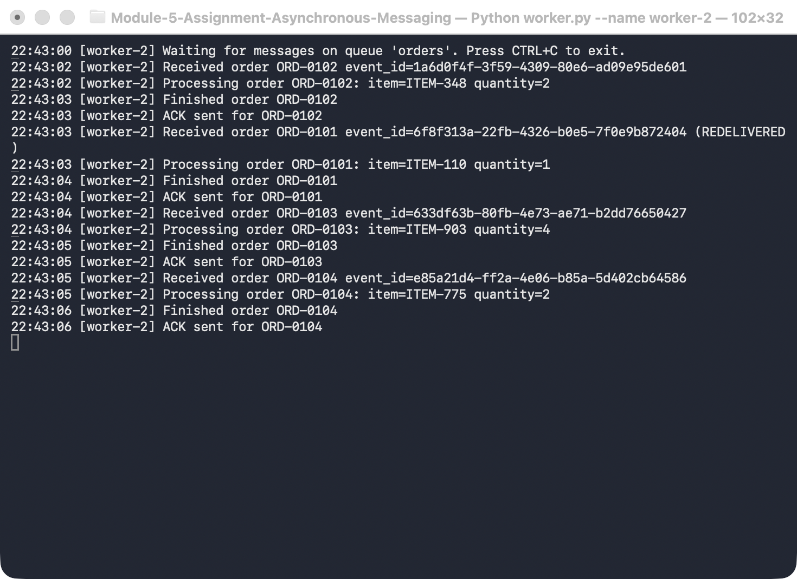
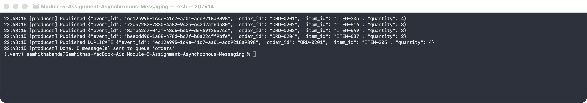
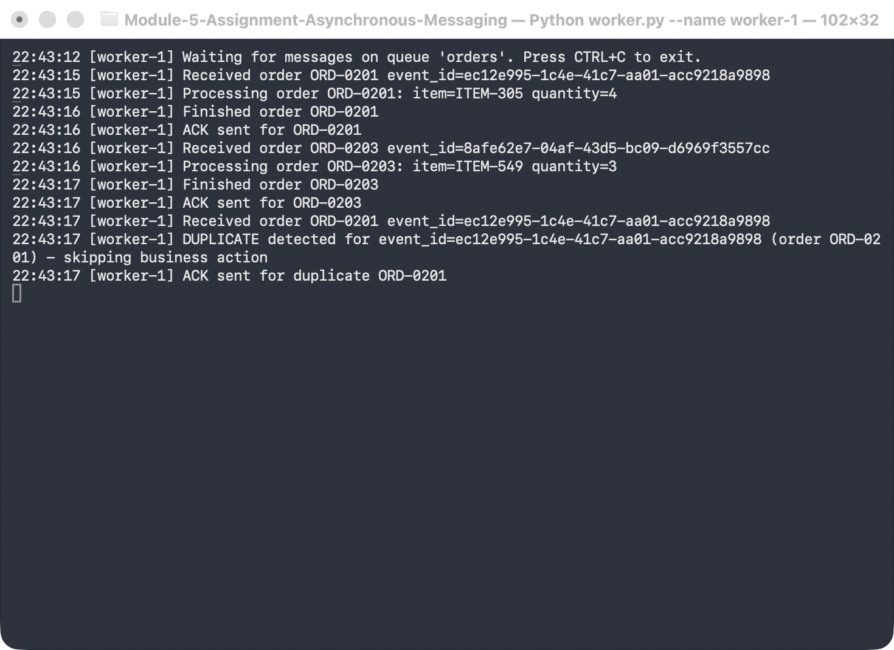
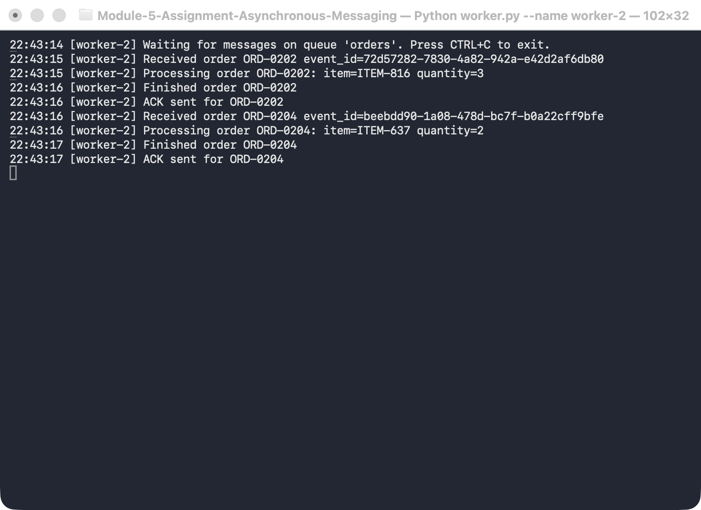
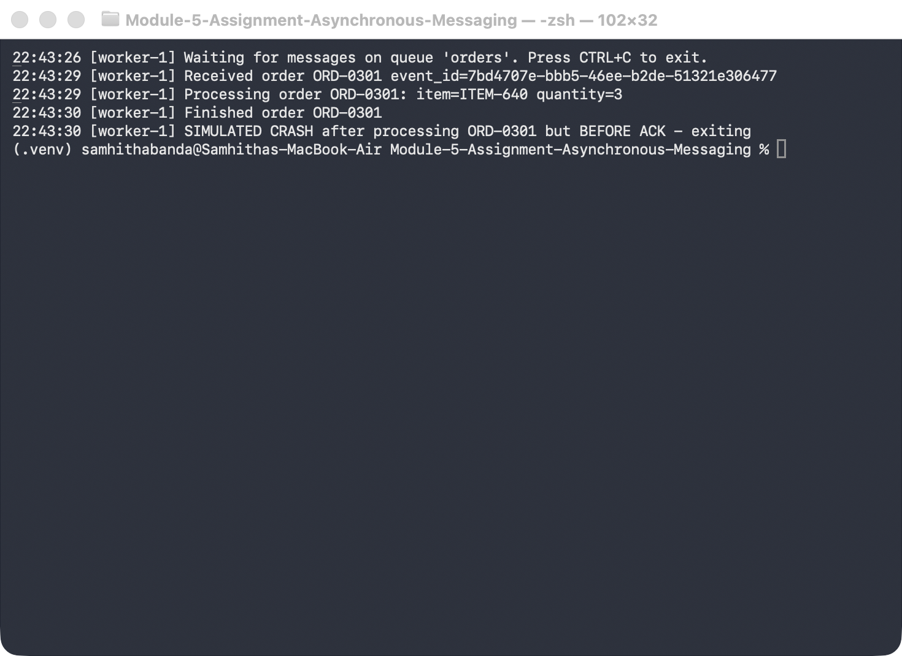
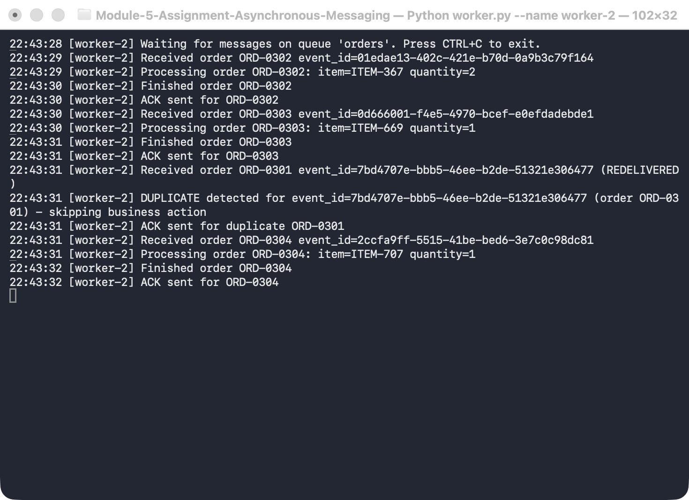

# Module 5 Assignment – Asynchronous Messaging with RabbitMQ

A small asynchronous order-processing system written in **Python** (using [`pika`](https://pypi.org/project/pika/)).

- **Order Producer** (`producer.py`) publishes order messages to the `orders` queue.
- **Order Worker** (`worker.py`) consumes orders, processes them, and sends an ACK when done.

The producer and the workers run as separate processes.

## Project Structure

```
.
├── common.py            # connection settings, queue declaration, logging
├── producer.py          # Order Producer
├── worker.py            # Order Worker (manual ACK, duplicate detection, crash simulation)
├── docker-compose.yml   # RabbitMQ broker with the management UI
├── requirements.txt
└── logs/                # terminal output captured from the demo runs
```

## Architecture

```
                         RabbitMQ broker
 ┌──────────────┐      ┌──────────────────┐      ┌──────────────┐
 │   Producer   │      │                  │ ───► │   worker-1   │──┐
 │ producer.py  │ ───► │  queue: "orders" │      └──────────────┘  │   ┌────────────────────────┐
 └──────────────┘      │ (durable, msgs   │      ┌──────────────┐  ├──►│ processed_events.txt   │
   publishes JSON      │   persistent)    │ ───► │   worker-2   │──┘   │ (event_ids already     │
   order events        └──────────────────┘      └──────────────┘      │  processed, shared)    │
                          ▲          │             manual ACK,          └────────────────────────┘
                          └── ACK ───┘             prefetch_count=1
                     un-ACKed msgs are requeued
                     if a worker dies
```

Message format:

```json
{
  "event_id": "cc833c71-121a-4606-8194-13375057f4e3",
  "order_id": "ORD-0001",
  "item_id": "ITEM-144",
  "quantity": 1
}
```

### Design notes

- **Manual ACKs** (`auto_ack=False`): a worker ACKs only after processing finishes. If it dies first, RabbitMQ requeues the message and delivers it to another worker, flagged `redelivered`.
- **Competing consumers**: both workers consume from the same queue. `prefetch_count=1` means each worker holds only one unacknowledged message at a time, so work is shared out fairly and each message goes to exactly one worker.
- **Idempotency**: processed `event_id`s are stored in `processed_events.txt`, which all workers share (file locking keeps concurrent writes safe). Before processing, a worker checks this file. If the `event_id` is already there, it logs `DUPLICATE detected`, skips the business action, and ACKs the message so it leaves the queue.
- **Durability**: the queue is durable and messages are published as persistent. Publisher confirms are enabled.

## How to Run

### 1. Start RabbitMQ

With Docker:

```bash
docker compose up -d
```

(or `docker run -d --name rabbitmq -p 5672:5672 -p 15672:15672 rabbitmq:4-management`)

The management UI is at http://localhost:15672 (login `guest` / `guest`).

### 2. Install dependencies

```bash
python3 -m venv .venv
source .venv/bin/activate
pip install -r requirements.txt
```

### 3. Start two workers (in two separate terminals)

```bash
python worker.py --name worker-1
```

```bash
python worker.py --name worker-2
```

### 4. Publish orders (in a third terminal)

```bash
python producer.py --count 10
```

### Other options

| Command | What it does |
|---|---|
| `python producer.py --count 5 --start 101` | Publishes 5 orders numbered `ORD-0101`…`ORD-0105` |
| `python producer.py --count 4 --duplicate` | Publishes 4 orders, then publishes the first one again with the **same** `event_id` |
| `python worker.py --name worker-1 --crash-on ORD-0101` | Worker exits **before** processing/ACKing `ORD-0101` |
| `python worker.py --name worker-1 --crash-on ORD-0301 --crash-mode after-process` | Worker processes `ORD-0301`, then exits **before** sending the ACK |
| `python worker.py --delay 2` | Simulated processing time per order (default 1 s) |

Connection settings can be overridden with the environment variables `RABBITMQ_HOST`, `RABBITMQ_PORT`, `RABBITMQ_USER`, `RABBITMQ_PASSWORD`, and `ORDER_QUEUE`.

To start fresh between demos, delete `processed_events.txt`.

---

## Results and Evidence

Full logs for every scenario are in [`logs/`](logs/).

The screenshots come from a later run against RabbitMQ in Docker, so their `event_id`s and timestamps differ from the log excerpts. The behavior is the same.

### 1. Successful message processing and two competing consumers

Commands:

```bash
python worker.py --name worker-1      # terminal 1
python worker.py --name worker-2      # terminal 2
python producer.py --count 10         # terminal 3
```

Producer ([logs/1-competing-producer.log](logs/1-competing-producer.log)):

```
19:50:01 [producer] Published {"event_id": "cc833c71-...", "order_id": "ORD-0001", "item_id": "ITEM-144", "quantity": 1}
19:50:01 [producer] Published {"event_id": "fe092914-...", "order_id": "ORD-0002", "item_id": "ITEM-790", "quantity": 4}
...
19:50:01 [producer] Published {"event_id": "f6850bfb-...", "order_id": "ORD-0010", "item_id": "ITEM-486", "quantity": 3}
19:50:01 [producer] Done. 10 message(s) sent to queue 'orders'.
```

worker-1 ([logs/1-competing-worker-1.log](logs/1-competing-worker-1.log)):

```
19:50:01 [worker-1] Received order ORD-0001 event_id=cc833c71-121a-4606-8194-13375057f4e3
19:50:01 [worker-1] Processing order ORD-0001: item=ITEM-144 quantity=1
19:50:02 [worker-1] Finished order ORD-0001
19:50:02 [worker-1] ACK sent for ORD-0001
19:50:02 [worker-1] Received order ORD-0004 ...
...  (processed ORD-0001, 0004, 0006, 0007, 0009)
```

worker-2 ([logs/1-competing-worker-2.log](logs/1-competing-worker-2.log)):

```
19:50:01 [worker-2] Received order ORD-0002 event_id=fe092914-d6d0-45f9-88d4-c4bc758e6feb
19:50:01 [worker-2] Processing order ORD-0002: item=ITEM-790 quantity=4
19:50:02 [worker-2] Finished order ORD-0002
19:50:02 [worker-2] ACK sent for ORD-0002
...  (processed ORD-0002, 0003, 0005, 0008, 0010)
```

**Result:** the 10 orders were split between the two workers, and each order was processed by exactly one of them (none twice, none missing).

<!-- TODO: add screenshot of the three terminals here -->

### 2. Failure and redelivery

worker-1 is started with `--crash-on ORD-0101`. It receives the message and exits before sending the ACK.

```bash
python worker.py --name worker-1 --crash-on ORD-0101   # terminal 1
python worker.py --name worker-2                       # terminal 2
python producer.py --count 4 --start 101               # terminal 3
```

worker-1 ([logs/2-crash-redelivery-worker-1.log](logs/2-crash-redelivery-worker-1.log)):

```
19:50:12 [worker-1] Received order ORD-0101 event_id=830ceddc-003c-41fd-b277-eec98d5e12e8
19:50:12 [worker-1] SIMULATED CRASH while processing ORD-0101 - exiting WITHOUT ACK
```

worker-2 ([logs/2-crash-redelivery-worker-2.log](logs/2-crash-redelivery-worker-2.log)):

```
19:50:12 [worker-2] Received order ORD-0102 event_id=8bdd2ab6-6072-4375-b128-d0cb8db077c4
19:50:12 [worker-2] Processing order ORD-0102: item=ITEM-294 quantity=2
19:50:13 [worker-2] Finished order ORD-0102
19:50:13 [worker-2] ACK sent for ORD-0102
19:50:13 [worker-2] Received order ORD-0101 event_id=830ceddc-003c-41fd-b277-eec98d5e12e8 (REDELIVERED)
19:50:13 [worker-2] Processing order ORD-0101: item=ITEM-238 quantity=1
19:50:14 [worker-2] Finished order ORD-0101
19:50:14 [worker-2] ACK sent for ORD-0101
19:50:14 [worker-2] Received order ORD-0103 ...
19:50:16 [worker-2] ACK sent for ORD-0104
```

**Result:**

1. worker-1 received `ORD-0101`.
2. It never sent an ACK, because the process died.
3. RabbitMQ noticed the closed connection, requeued the message, and delivered it to worker-2, which marked it `(REDELIVERED)` and processed it.

The system kept running: worker-2 and the broker were unaffected, and all four orders were processed.

**Screenshots:**

*Producer: publishes ORD-0101 to ORD-0104*


*worker-1: receives ORD-0101 and crashes before sending the ACK*



*worker-2: receives ORD-0101 again, marked REDELIVERED, and processes it*




### 3. Duplicate handling

The producer publishes 4 orders, then publishes `ORD-0201` again with the **same** `event_id`.

```bash
python producer.py --count 4 --start 201 --duplicate
```

Producer ([logs/3-duplicate-producer.log](logs/3-duplicate-producer.log)):

```
19:50:21 [producer] Published {"event_id": "9edf129e-31ce-4db4-827b-0bf190a33c3b", "order_id": "ORD-0201", ...}
...
19:50:21 [producer] Published DUPLICATE {"event_id": "9edf129e-31ce-4db4-827b-0bf190a33c3b", "order_id": "ORD-0201", ...}
```

worker-1 processed the original ([logs/3-duplicate-worker-1.log](logs/3-duplicate-worker-1.log)):

```
19:50:21 [worker-1] Received order ORD-0201 event_id=9edf129e-31ce-4db4-827b-0bf190a33c3b
19:50:21 [worker-1] Processing order ORD-0201: item=ITEM-488 quantity=2
19:50:22 [worker-1] Finished order ORD-0201
19:50:22 [worker-1] ACK sent for ORD-0201
```

worker-2 received the duplicate ([logs/3-duplicate-worker-2.log](logs/3-duplicate-worker-2.log)):

```
19:50:23 [worker-2] Received order ORD-0201 event_id=9edf129e-31ce-4db4-827b-0bf190a33c3b
19:50:23 [worker-2] DUPLICATE detected for event_id=9edf129e-31ce-4db4-827b-0bf190a33c3b (order ORD-0201) - skipping business action
19:50:23 [worker-2] ACK sent for duplicate ORD-0201
```

**Result:** the business action for `ORD-0201` ran only once. The second copy was detected, logged, and ACKed without being processed again. This worked across workers because the set of processed `event_id`s is shared.

**Screenshots:**

*Producer: publishes ORD-0201 a second time with the same event_id*



*worker-1: processes ORD-0201, then detects the duplicate and skips it*



*worker-2: processes its own orders normally*




### 4. Bonus: crash after processing but before the ACK

This is the case that makes duplicates happen in real systems. worker-1 finishes the business action and then dies before ACKing.

```bash
python worker.py --name worker-1 --crash-on ORD-0301 --crash-mode after-process
python worker.py --name worker-2
python producer.py --count 4 --start 301
```

worker-1 ([logs/4-crash-after-process-worker-1.log](logs/4-crash-after-process-worker-1.log)):

```
19:50:31 [worker-1] Received order ORD-0301 event_id=e6fc5e9a-7191-4da1-81f3-e42d35e9a4f0
19:50:31 [worker-1] Processing order ORD-0301: item=ITEM-927 quantity=3
19:50:32 [worker-1] Finished order ORD-0301
19:50:32 [worker-1] SIMULATED CRASH after processing ORD-0301 but BEFORE ACK - exiting
```

worker-2 ([logs/4-crash-after-process-worker-2.log](logs/4-crash-after-process-worker-2.log)):

```
19:50:33 [worker-2] Received order ORD-0301 event_id=e6fc5e9a-7191-4da1-81f3-e42d35e9a4f0 (REDELIVERED)
19:50:33 [worker-2] DUPLICATE detected for event_id=e6fc5e9a-7191-4da1-81f3-e42d35e9a4f0 (order ORD-0301) - skipping business action
19:50:33 [worker-2] ACK sent for duplicate ORD-0301
```

**Result:** RabbitMQ redelivered `ORD-0301` because it was never ACKed. Without the idempotency check, the order would have been processed twice. With it, worker-2 detects that the event was already handled and only ACKs it.

**Screenshots:**

*Producer: publishes ORD-0301 to ORD-0304*


*worker-1: finishes ORD-0301, then crashes before sending the ACK*



*worker-2: receives ORD-0301 as REDELIVERED, detects it as a duplicate, and does not process it again*




---

## Reflection

<!-- TODO: write your 3–5 sentence reflection here -->
